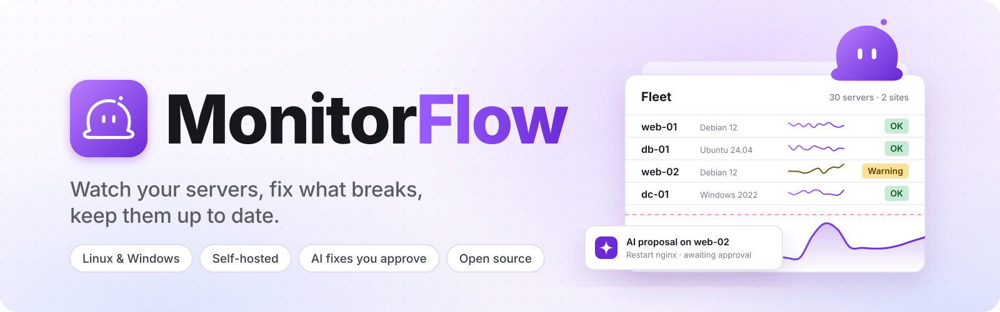
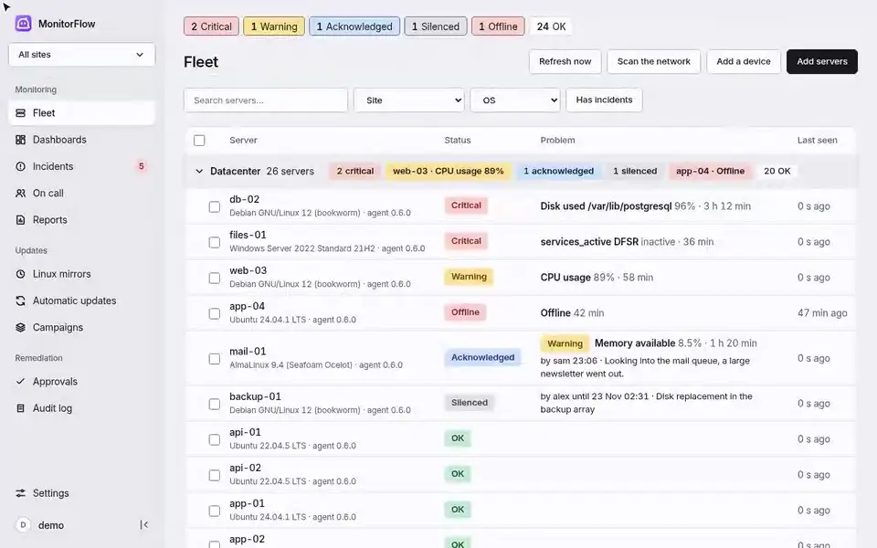
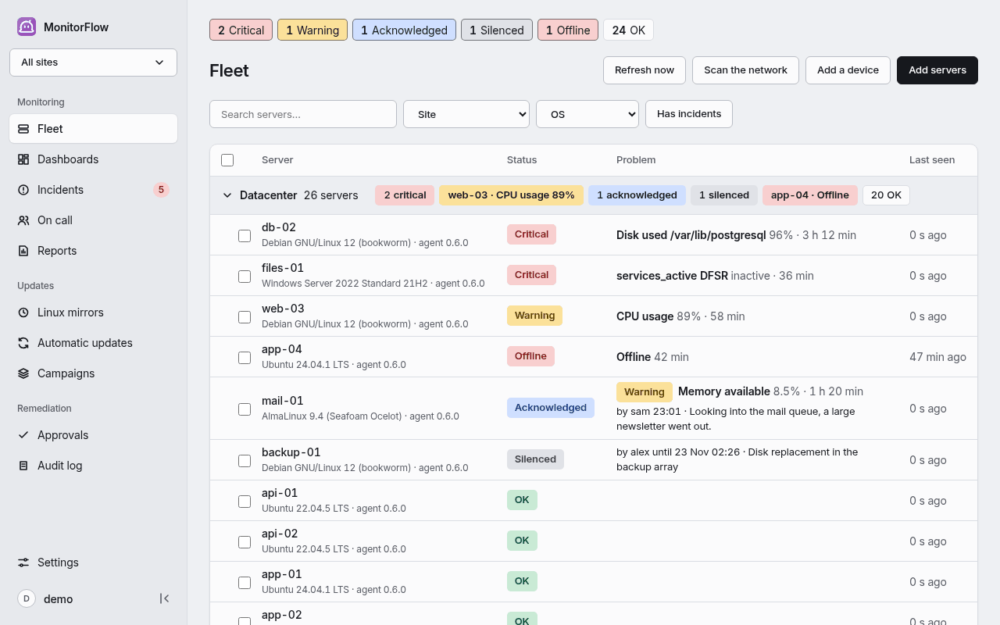
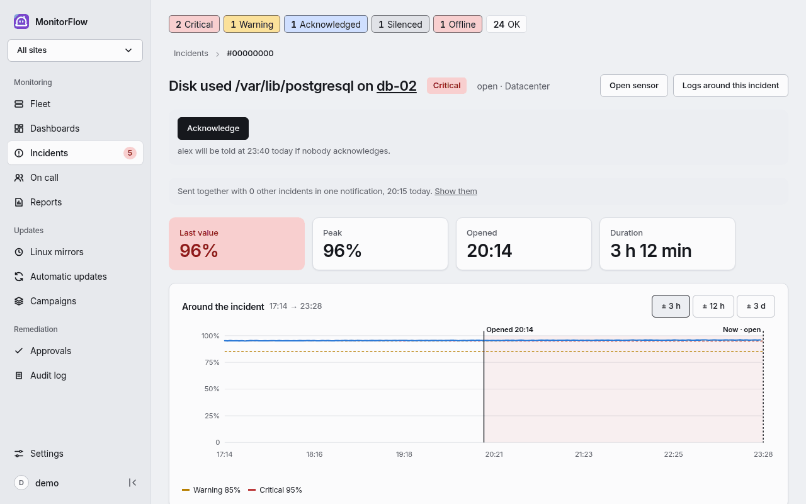
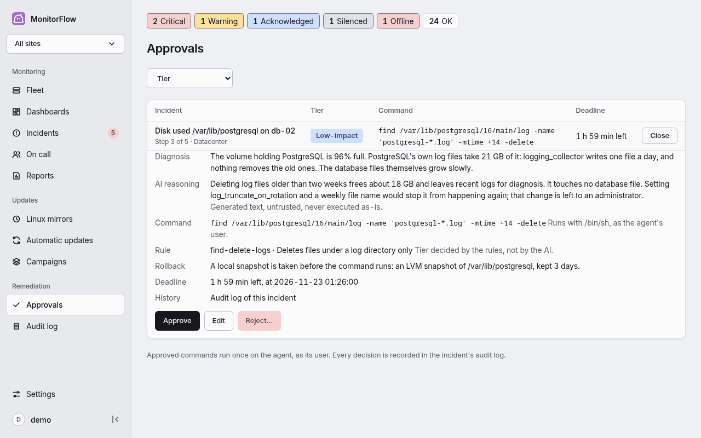
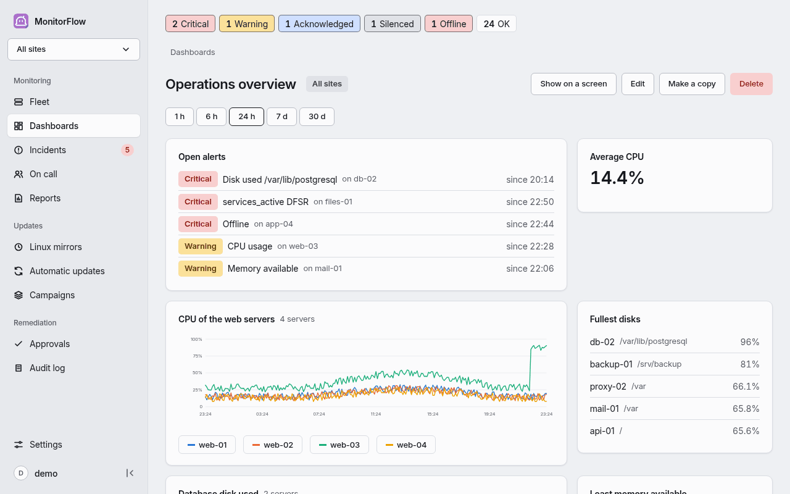
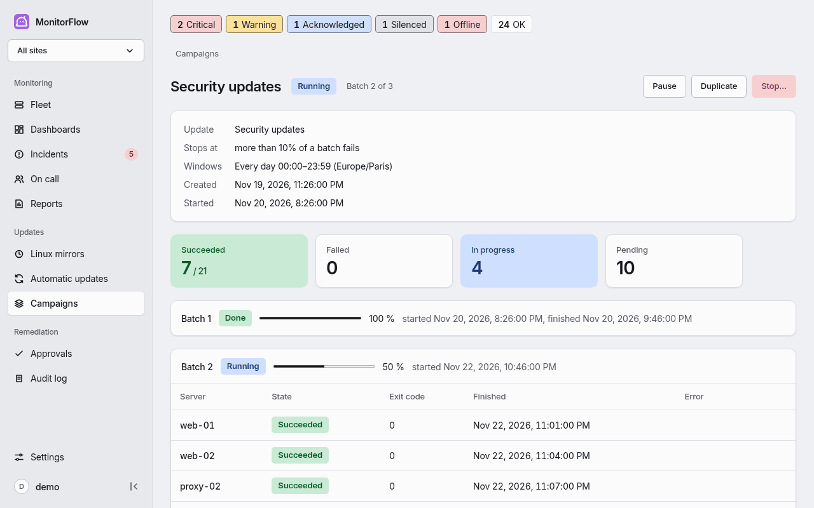
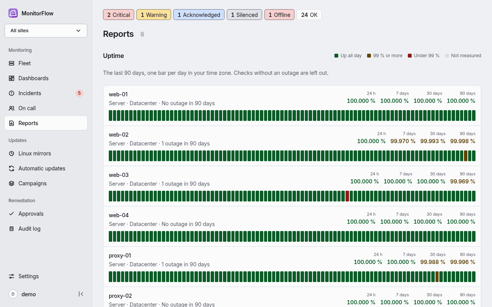
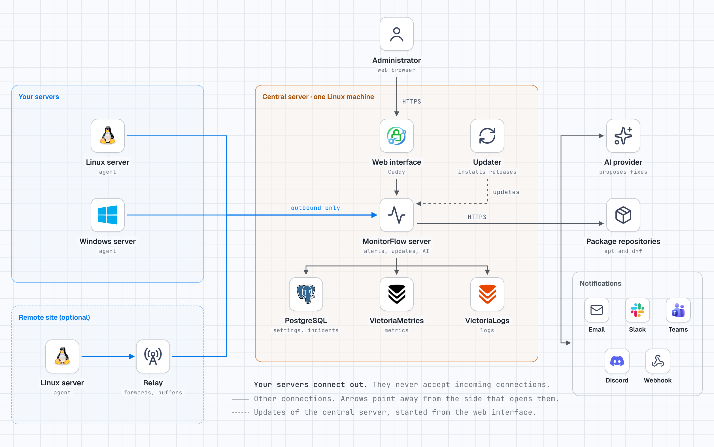

<picture>
  <source media="(prefers-color-scheme: dark)" srcset="docs/images/banner-dark.svg">
  
</picture>

<p align="center">
  <a href="https://github.com/Kidoly/monitorflow/releases/latest"></a>
  <a href="https://github.com/Kidoly/monitorflow/actions/workflows/ci.yml?query=branch%3Amain"></a>
  <a href="LICENSE"></a>
  
</p>

<p align="center">
  <strong>Open source monitoring and fleet management for your Linux and Windows servers.</strong><br>
  MonitorFlow watches your servers, tells you when something goes wrong, and keeps them up to date, all from one web page.<br>
  Made for a company running its own servers and for service providers running servers for their customers.
</p>

<p align="center">
  <a href="#get-started-in-5-minutes">Get started</a> ·
  <a href="#how-it-works">How it works</a> ·
  <a href="docs/deploy-server.md">Guides</a> ·
  <a href="docs/api/openapi.json">API</a> ·
  <a href="CONTRIBUTING.md">Contributing</a>
</p>

<picture>
  <source media="(prefers-color-scheme: dark)" srcset="docs/images/screens/tour-dark.webp">
  
</picture>

> [!NOTE]
> **Early development.** The one-line installer installs the [latest release](https://github.com/Kidoly/monitorflow/releases/latest). Some features described in `docs/` are only on the `main` branch and come with the next release.

## What you get

### Your whole fleet on one page

Every server, its state and what is wrong with it, grouped by site. Problems first, the rest below.

<picture>
  <source media="(prefers-color-scheme: dark)" srcset="docs/images/screens/fleet-dark.png">
  
</picture>

### Incidents that tell the whole story

When a limit is crossed, an incident opens with the graph around it, its thresholds and its timeline, and you are notified by email, webhook, Slack, Teams or Discord.

<picture>
  <source media="(prefers-color-scheme: dark)" srcset="docs/images/screens/incident-dark.png">
  
</picture>

### An AI that proposes, a person who decides

The AI diagnoses the alert and proposes a command. Rules, not the AI, decide how risky it is, and nothing runs before someone approves it. Every step goes to an audit log.

<picture>
  <source media="(prefers-color-scheme: dark)" srcset="docs/images/screens/ai-diagnosis-dark.png">
  
</picture>

### Dashboards for the team and the wall screen

Build your own, and show them on a TV with a display link that needs no sign-in.

<picture>
  <source media="(prefers-color-scheme: dark)" srcset="docs/images/screens/dashboard-dark.png">
  
</picture>

### Updates in waves, during your hours

MonitorFlow keeps copies of the Debian, Ubuntu and RHEL package repositories, and updates servers batch by batch. A campaign stops by itself if too many fail.

<picture>
  <source media="(prefers-color-scheme: dark)" srcset="docs/images/screens/campaign-dark.png">
  
</picture>

### Uptime you can show

90 days of uptime per server, and availability reports for each customer as PDF or CSV.

<picture>
  <source media="(prefers-color-scheme: dark)" srcset="docs/images/screens/uptime-dark.png">
  
</picture>

## How it works

<picture>
  <source media="(prefers-color-scheme: dark)" srcset="docs/images/architecture-dark.png">
  
</picture>

- **An agent runs on each server.** It measures CPU, memory, disks, services, ports and logs, and sends them to the central server.
- **Agents only connect out.** Your servers never accept incoming connections: nothing to open in their firewall. Every connection is encrypted and both sides prove who they are with certificates (this is called mutual TLS, or mTLS).
- **A relay is optional.** At a remote site, one relay passes on the traffic of the servers behind it, and keeps their data while the link is down.
- **The central server does the rest.** It stores metrics and logs, opens an alert when a limit is crossed, and notifies you by email, webhook, Slack, Teams or Discord.
- **It keeps servers up to date.** It keeps copies of the Debian, Ubuntu and RHEL package repositories and updates servers in waves, during the hours you choose.
- **An AI can propose fixes, never run them alone.** When an alert opens, an AI can diagnose it and suggest a command: Anthropic, OpenAI or any compatible API, or a local model so nothing leaves your network. A person approves it before it runs, and everything is written to an audit log.

## Get started in 5 minutes

### 1. Check the requirements

- A Linux machine for the central server: 2 vCPU and 4 GB of RAM are enough for a few dozen servers. Docker is installed for you if it is missing.
- Ports your browsers and servers can reach on it: **443** and **80** (web interface), **7443** and **7445** (agents and relays), **7480** (packages, if you use updates).
- Servers to watch: any Linux with systemd (x86_64 or ARM64), or Windows.

### 2. Install the central server

On the central machine, run:

```sh
curl -fsSL https://github.com/Kidoly/monitorflow/releases/latest/download/install-server.sh | sudo sh
```

It asks one question, the public name: the name browsers and agents will use to reach this machine, like `monitor.example.com` or an IP address. Press Enter to accept the one it suggests. It then sets everything up and prints the address of the web interface and a one-time link. Nothing to clone, build or edit.

### 3. Create the administrator

Open the one-time link in your browser and choose the administrator's name and password. The link works once, for 24 hours.

### 4. Trust the certificate (IP address or internal name only)

If you used a public name, like `monitor.example.com`, you get a free certificate and can skip this step.

With an IP address or an internal name, like `monitor.lan`, the server signs its own certificate, so your browser warns you at first. To fix that, open `http://<name>/trust/` once on each computer and follow the steps for your system. That page arrives unencrypted: check that it shows the same fingerprint (a short code) the installer printed.

### 5. Add your servers

In the web interface, open **Administration › Add servers** and copy the command. It looks like this:

```sh
curl -fsSL https://github.com/Kidoly/monitorflow/releases/latest/download/install.sh \
  | sudo MF_SERVER=monitor.example.com:7443 MF_TOKEN=mfe1.… sh
```

Paste it on each Linux server. The same command works for all of them. For Windows, choose Windows on the same page and run the line it shows in PowerShell as administrator.

### 6. Watch them arrive

Within seconds, each server appears in the fleet under its own name, online, with its first graphs. That's it.

## Next steps

Most of these are pages under **Administration** in the web interface:

- **Notifications**: get an email, a webhook call, or a Slack, Teams or Discord message when an alert opens or an update fails.
- **Alerts**: open a server and use its **Sensors** tab to change limits or add checks.
- **Linux mirrors** and update campaigns: copy Linux package repositories to the central server and update servers in waves. See [Installing the agent](docs/deploy-agent.md#pointing-a-server-at-the-mirrors).
- **AI**: choose a provider (Anthropic, OpenAI or a compatible API, or a local model) so the AI can diagnose alerts and propose fixes you approve.
- **Backups**: one backup a day, the last 7 kept, and **Back up now**. See [Data and backups](docs/deploy-server.md#data-and-backups).
- **Dashboards**: build your own, and show them on a wall screen or TV with a display link that needs no sign-in.
- **API keys** and **Integrations**: drive everything the web interface does through the [public API](docs/api/openapi.json), which you can try from Swagger UI at `/api/v1/swagger/` on your server, and send incidents and updates to other tools with signed webhooks. See [Integrations](docs/integrations.md).
- **Plugins**: add checks and notification channels without changing MonitorFlow. See [Write a plugin](docs/plugins.md).
- **Server update**: when a new release is out, a banner says so. Click **Check for updates**, then **Update**. A backup is taken first, and it rolls back on its own if something fails. See [Updating](docs/deploy-server.md#updating).

The full guides are [Installing the server](docs/deploy-server.md), [Installing the agent](docs/deploy-agent.md) and [Installing a relay](docs/deploy-relay.md).

<details>
<summary><strong>Troubleshooting</strong></summary>

**The installer stops with "Docker could not be installed".** It prints the last lines of Docker's own installer above. If they show `E: dpkg was interrupted`, the machine's package manager was stopped halfway, often by an automatic update. Repair it, then run the installer again:

```sh
sudo dpkg --configure -a
```

On a distribution Docker's script does not cover, install Docker Engine 23 or later and its compose plugin with your package manager, then run the installer again.

**The installer says "port … is already in use".** Another program uses that port. `sudo ss -ltnp` shows which one. Stop it, or follow the installer's message to use another port, then run the installer again.

**The one-time link has expired or was lost.** Run the server installer again: it keeps your settings and data and prints a new link.

**The browser says the connection is not private.** You used an IP address or an internal name. Do step 4: open `http://<name>/trust/` on that computer.

**A server does not appear in the fleet.** The agent installer prints the reason and the end of the agent's log. Most often the server cannot reach ports 7443 and 7445 of the central server, or the command was revoked or has expired. Fix it, copy a fresh command from Add servers, and run it again. `journalctl -u monitorflow-agent` shows the agent's log.

</details>

<details>
<summary><strong>Uninstall</strong></summary>

**Central server** (asks whether to delete the data; Docker stays installed):

```sh
curl -fsSL https://github.com/Kidoly/monitorflow/releases/latest/download/install-server.sh | sudo sh -s -- --uninstall
```

**Agent on Linux**: on the server's page, choose **Remove**. It stops the server from connecting and shows the exact command, which is:

```sh
curl -fsSL https://github.com/Kidoly/monitorflow/releases/latest/download/install.sh | sudo MF_UNINSTALL=1 sh
```

**Agent on Windows**: choose **Remove** on the server's page, and run the command it shows in PowerShell as administrator.

</details>

## For MSPs and remote sites

- **Customers** keep their servers, sites and notifications apart, and a user's role can cover everything, one customer or one site. A single company never sees them: they appear once you add a second customer under **Administration › Sites**, and a customer's own users see only their servers.
- **Sites** group the servers of one place. Each site has its own install command.
- **Relays** serve a site whose servers cannot reach the central server directly. The relay connects out to the central server, the site's servers connect to the relay, and it can keep a local copy of the packages. Add one under **Administration › Relays**. See [Installing a relay](docs/deploy-relay.md).

## Contributing

MonitorFlow is written in Rust, with a Next.js web interface. To build it, you need `rustup`, `protoc`, Docker, and Node 26 (`web/.nvmrc`) for the web interface.

```sh
docker compose -f deploy/docker-compose.dev.yml up -d
cp .env.example .env
cargo build --workspace
scripts/check.sh
```

Start with [Architecture](docs/architecture.md), the [product](docs/product.md) and the [roadmap](docs/roadmap.md). [CONTRIBUTING.md](CONTRIBUTING.md) explains how to build, test and work on the web interface. Everyone who takes part follows the [code of conduct](CODE_OF_CONDUCT.md).

## Security

To report a vulnerability, see `SECURITY.md`. Please do not open a public issue.

## Licence

AGPL-3.0-or-later. See `LICENSE`. Contributions require signing the CLA (see `CONTRIBUTING.md`).

Everything is free except the Enterprise edition: running more than one central server for high availability, whose code in `ee/` is public under `ee/LICENSE` and needs a subscription in production (ADR-0100). To get one, open an issue titled "Enterprise subscription".
